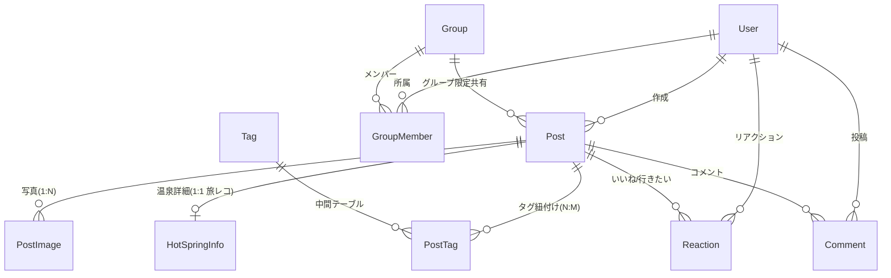

# 食べレコ (mogureco) プロジェクト総合コンテキスト資料 (AI_CONTEXT.md)

本資料は、外部のAI（ChatGPT等）や新任エンジニアが「食べレコ（mogureco）」の全体像、設計思想、アーキテクチャ、実装済み機能、制約事項を正確に理解し、新規機能の提案・改善案の検討・コード開発をスムーズに行えるようにまとめたマスターコンテキストドキュメントです。

---

## 1. アプリの目的とコンセプト

### 1.1 基本コンセプト
「**食べレコ**（内部プロジェクト識別名: `mogureco`）」は、訪問した飲食店や自炊料理の記録（写真、評価、感想、価格帯、位置情報等）を簡単・直感的に保存し、友人・パートナー・家族などの特定グループとリアルタイムに共有できるフルスタックWebアプリケーション（PWA対応）です。

### 1.2 コアバリュー: デュアルモードアーキテクチャ
本アプリ最大の特徴は、**「食べレコ（グルメ記録）」**と**「旅レコ（温泉・宿記録）」**の2つのサービスモードを、同一のコードベース・単一のデータベース上でシームレスに切り替えて利用できる点にあります。
- **食べレコモード（テーマカラー: Rose `#f43f5e`）:**
  飲食店、カフェ、居酒屋、ラーメン店、手料理などのグルメ体験をコレクション。
- **旅レコモード（テーマカラー: Lime `#84cc16`）:**
  温泉、日帰り入浴、旅館、サウナの体験を記録。泉質、サウナ温度、水風呂温度、源泉掛け流し有無などの専用パラメータを入力・管理可能。

Cookie（`app_type`）と React Context によって、UIのブランドカラー・アプリアイコン・入力項目・検索フィルター・取得データが動的に切り替わります。

---

## 2. 想定ユーザーと利用シーン

### 2.1 想定ターゲット層
1. **グルメ愛好家・外食が多いユーザー:**
   「あの店、美味しかったけど何て名前だっけ？」「次どこ行く？」を解消し、自分だけのマイベスト店舗やジャンル別ランキングを整理したい人。
2. **カップル・夫婦・親しい友人グループ:**
   「行ったお店」だけでなく「行きたいお店」を共有し、週末の食事や旅行の計画を立てたいグループ。
3. **温泉・サウナ・旅行愛好家（旅レコモード）:**
   全国の立ち寄り湯や宿を巡り、泉質や水風呂の温度、サウナの有無などをマニアックに記録・振り返りたい人。

### 2.2 主要な利用シーン
- **退店時・食事中:** スマホからGoogle Mapsスポット検索で店名を入力。住所・位置情報を自動補完し、撮影した料理写真を複数枚アップロードして即座に投稿。
- **週末の店選び:** マップ画面から「現在地周辺」や保存したピンを一覧表示。あるいはカレンダーから前回の訪問時期を確認。
- **今日のご飯に迷った時:** ホーム画面の「ルーレット」を回し、保存済みの「行きたい」「行った」お店からランダムに決定。
- **マイベストランキングの編成:** 「#ラーメン」「#焼肉」などのタグごとに、ドラッグ＆ドロップでお気に入り順位を直感的に並び替え。

---

## 3. 現在実装されている機能一覧

| 分野 | 機能名称 | 実装状況 | 概要 |
| :--- | :--- | :---: | :--- |
| **認証・認可** | AWS Cognito Hosted UI 連携 | 実装済み | OAuth 2.0 / JWT (ID, Access, Refresh Token) による認証 |
| | PWA 永続化セッション | 実装済み | iOS PWA のタスクキル対策として LocalStorage RT による自動トークン復旧 |
| | ゲストログイン | 実装済み | アカウント登録なしで体験できるゲストセッション |
| **モード切替** | 食べレコ ⇄ 旅レコ 切替 | 実装済み | Cookie & Context による動的テーマ・UI・データ分離 |
| **投稿管理** | 投稿作成・編集・削除 | 実装済み | 写真、店名、訪問日、星評価、価格帯、利用シーン、感想、公開範囲 |
| | Google Places 住所補完 | 実装済み | 店名入力から住所・緯度経度・PlaceIdを自動取得（モバイル誤タップ防止スクロール対応） |
| | 店舗写真取得（任意） | 実装済み | Google Places からオフィシャル写真を抽出して投稿写真に含める機能（既定OFF） |
| | EXIF 位置情報自動抽出 | 実装済み | アップロード写真のEXIF GPSメタデータから撮影地・日時を自動抽出 |
| | バックグラウンドアップロード | 実装済み | 画面遷移後もアップロードをバックグラウンド実行し上部プログレスバーで通知 |
| | 温泉・宿専用フィールド | 実装済み | 旅レコ時のみ泉質、サウナ温度、水風呂、掛け流し等の詳細入力 |
| **タイムライン** | 投稿一覧・無限スクロール | 実装済み | すべて／行った／行きたい の3タブ切り替え表示 |
| | SWR キャッシュ即時無効化 | 実装済み | 投稿作成・更新・削除時に一覧を即座に再同期（楽観的反映） |
| | リアクション & コメント | 実装済み | 「いいね」「行きたい」のワンタップトグル、詳細モーダルでのコメント |
| **検索・絞り込み** | 共有フィルター (`useSharedFilter`) | 実装済み | モード別に LocalStorage と CustomEvent で画面間（タイムライン/マップ/カレンダー/統計）の検索条件を完全同期 |
| | 都道府県マップ連動 | 実装済み | ホームの日本地図で都道府県をタップするとタイムラインが該当県で自動絞り込み |
| **マップ機能** | Google Maps ピン描画 | 実装済み | 記録店舗のカスタムピン表示、ピンタップ時のボトムシートカードプレビュー |
| | 初期全日本ビュー | 実装済み | 初回読み込み時は日本全体が見渡せる最適ズーム・中央配置 |
| | 現在地取得ボタン | 実装済み | GPS から現在地へスムーズスクロール |
| **ランキング** | タグ別マイランキング | 実装済み | タグ（ジャンル）ごとに店舗を `@dnd-kit` でドラッグ＆ドロップ並び替え |
| | 友達／自分トグル | 実装済み | グループ全体の平均評価順と自分独自の順位付けの切り替え |
| **カレンダー** | 訪問日カレンダー | 実装済み | 月別カレンダー上に食事写真アイコンを配置、日付タップでその日の食事一覧表示 |
| **統計分析** | マイページダッシュボード | 実装済み | 月別投稿数棒グラフ、評価分布チャート、47都道府県訪問ヒートマップ |
| **グループ** | グループ管理 | 実装済み | グループ作成、6桁招待コード発行・参加、メンバー一覧、公開範囲連動 |
| **タグ管理** | タグ一覧・ソート | 実装済み | タグ新規作成、カラー設定、DnDによる表示優先度の並び替え |
| **画像基盤** | S3 + CloudFront | 実装済み | Cognito 直接署名PUT 優先 ＋ Presigned URL ＋ S3-Proxy の3段フォールバック |
| | 相対S3キーによるDB保存 | 実装済み | DBにはドメインを含めず `posts/xxx.webp` のみ保持しCDN移行に耐えうる設計 |
| | 孤立画像クリーンアップ | 実装済み | DB削除時のS3連動削除および定期クリーンアップスクリプト |
| **PWA / 通知** | Web App Manifest & Push | 実装済み | インストール可能PWA、VAPID Web Push 通知基盤 |

---

## 4. 各機能の具体的な動作とユーザー操作

### 4.1 投稿作成フロー（新規投稿: `/posts/new`）
1. **写真の選択:**
   - ユーザーが端末から写真を選択（複数可）。
   - クライアント側で `exif-js` を用いて EXIF データを解析。位置情報（緯度・経度）や撮影日時が存在すれば、フォームの「訪問日」およびマップ検索の初期値に自動反映。
2. **店舗名の入力と Places 検索:**
   - 店名を入力すると、Google Places Autocomplete が起動（300ms デバウンス）。
   - 候補一覧がドロップダウン表示される。モバイル端末でのスクロール操作時に誤タップで確定しないよう、`touchmove` 追跡ガードを実装。
   - 候補を選択すると、店舗名・住所・緯度経度・Google Place ID が自動入力される。
3. **追加情報の入力:**
   - 訪問ステータス（「行った」または「行きたい」）。
   - 星評価（1.0〜5.0）、価格帯（昼/夜）、利用シーン（デート、友人、一人等）。
   - タグの選択（複数選択、またはインラインで新規タグ追加）。
   - 旅レコモード時は「温泉詳細」アコーディオンを展開し、泉質・サウナ・水風呂などを入力。
4. **保存とバックグラウンドアップロード:**
   - 「投稿する」を押すと、一時プレビューを作成して即座にタイムライン画面へ遷移。
   - 画像アップロードは `UploadContext` を通じてバックグラウンドで処理され、画面上部のプログレスバーで完了が通知される。

### 4.2 タイムラインとフィルター連動（`/posts`）
- **表示切替:** 上部タブで「すべて」「行った」「行きたい」を切り替え。
- **絞り込みモーダル:**
  - 右上のフィルターボタンを押すとモーダルが開き、フリーワード、タグ（AND/OR）、評価下限〜上限、価格帯、投稿者（自分のみ／グループ）、期間を設定可能。
  - 設定内容は `useSharedFilter` により即時 `localStorage` に保存され、`sharedFilterChange` イベントを通じてマップ画面やカレンダー画面にも自動同期される。
- **都道府県マップ連動:**
  - ホーム画面の日本地図（SVG）で例えば「北海道」をタップすると、タイムライン画面へ自動遷移し、住所フィルターに「北海道」が適用された状態で即座に一覧表示される。

### 4.3 マイランキング画面（`/rankings`）
- ユーザーが登録したタグ（例: `#ラーメン`, `#カフェ`）が上部にチップ一覧表示される。
- タグを選択すると、そのタグが紐付けられた店舗一覧が表示される。
- 各カードのドラッグハンドルを掴んで上下にドラッグ＆ドロップすると、順位がリアルタイムに入れ替わり、1位には王冠（金）、2位（銀）、3位（銅）のバッジが付与される。
- 並び順は `/api/posts/reorder` を通じて `rank` カラムに即座に永続化される。

---

## 5. 画面構成と画面遷移

### 5.1 画面マップ
```text
[ログイン / ゲスト]
       │
       ▼
[ホーム画面 /] ──────────────────────────────────────────┐
  ├── 今日のごはんルーレットモーダル                      │
  ├── 思い出振り返りカード                                │
  ├── 周辺スポットリスト                                  │
  └── 都道府県制覇マップ ──(県タップ)──┐                   │
                                       │                   │
  ┌────────────────────────────────────┘                   │
  │                                                        │
  ▼                                                        ▼
[タイムライン /posts] ◄─────────────────────────► [マップ検索 /map]
  ├── すべて / 行った / 行きたい タブ                     ├── 日本全体ビュー
  ├── 絞り込みフィルターモーダル                         ├── 現在地追従ボタン
  ├── 投稿詳細モーダル /posts/[id]                        └── 店舗プレビューカード
  │     ├── コメント追加
  │     └── 編集・削除リンク
  └── 新規投稿画面 /posts/new
        └── Google Places オートコンプリート

  ┌────────────────────────────────────────────────────────┐
  │ 共通ボトムナビゲーション                                │
  ├──────────────┬──────────────┬─────────────┬────────────┤
  ▼              ▼              ▼             ▼            ▼
[ホーム]     [タイムライン]   [マップ]    [カレンダー]   [マイページ]
  (/)           (/posts)        (/map)     (/calendar)    (/mypage)

  ┌────────────────────────────────────────────────────────┐
  │ その他の主要画面                                        │
  ├── [マイランキング] /rankings  (タグ別お気に入り順位DnD) │
  ├── [タグ管理]       /tags      (タグ作成・カラー・ソート)│
  ├── [グループ管理]   /groups    (招待コード・メンバー)    │
  └── [各種設定]       /settings  (プロフィール・ログアウト)│
```

---

## 6. データベースと主要なデータ構造 (Prisma ORM)

PostgreSQL (Neon Serverless) 上に構築された 15 個のテーブルで構成されます。

### 6.1 主要エンティティ関係図 (ER概念)


### 6.2 主要テーブルのスキーマ詳細
1. **`User` (ユーザー):**
   - `id` (UUID), `cognitoSub` (Cognito一意ID), `email`, `name`, `avatarUrl`, `createdAt`
2. **`Post` (投稿 - 最重要テーブル):**
   - `id` (UUID), `userId`, `appType` (`"tabereco"` / `"tabireco"`)
   - `restaurantName` (店舗名/施設名), `visitedAt` (訪問日), `status` (`"visited"` / `"want_to_go"`)
   - `rating` (Float 1.0〜5.0), `priceRange` (価格帯文字列), `scene` (利用シーン), `comment` (本文)
   - `address` (住所), `latitude`, `longitude` (Float, マップ用), `googlePlaceId` (Places API ID)
   - `visibility` (`"public"` / `"group"` / `"private"`), `groupId` (共有グループID)
   - `rank` (Int, ランキング並び順用)
3. **`PostImage` (投稿画像):**
   - `id`, `postId`, `s3Key` (相対パス: `posts/uuid.webp`), `order` (表示順)
4. **`HotSpringInfo` (温泉・宿泊情報 - 旅レコ専用):**
   - `id`, `postId` (Unique), `springQuality` (泉質), `springTempType` (温度分類)
   - `saunaTemp` (サウナ温度), `waterBathTemp` (水風呂温度), `isFreeFlowing` (源泉掛け流し)
   - `hasOpenAirBath` (露天風呂), `hasPrivateBath` (家族風呂/客室風呂), `stayType` (宿泊/日帰り)
5. **`Tag` & `PostTag` (タグ管理):**
   - `Tag`: `id`, `name`, `color` (HEX), `appType`, `orderIndex`
   - `PostTag`: `postId`, `tagId` の複合主キー
6. **`Group` & `GroupMember` (グループ共有):**
   - `Group`: `id`, `name`, `inviteCode` (6桁英数字), `ownerId`
   - `GroupMember`: `groupId`, `userId`, `role` (`"owner"` / `"member"`)

---

## 7. APIと外部サービスとの連携

### 7.1 内部 REST API (Next.js Route Handlers)
- `/api/auth/*`: `login`, `callback`, `refresh`, `logout`, `guest` (Cognito OAuth 認証)
- `/api/posts`: 投稿一覧取得（GET、多彩なフィルタリング・ページネーション）、新規作成（POST）
- `/api/posts/[id]`: 詳細取得（GET）、更新（PUT）、削除（DELETE - S3連動クリーンアップ）
- `/api/posts/reorder`: ランキング順位一括更新（PUT）
- `/api/upload/presign`: AWS S3 署名付きアップロード URL 発行（POST）
- `/api/upload/s3-credentials`: Cognito Identity Pool 一時クレデンシャル取得（GET）
- `/api/upload`: サーバーサイド S3 Proxy アップロード（POST、フォールバック用）
- `/api/groups`: グループ一覧・作成・参加
- `/api/stats`: 統計ダッシュボード用集計データ取得
- `/api/tags`: タグ一覧・作成・並び替え

### 7.2 外部サービス連携
1. **AWS Cognito User Pool & Identity Pool:**
   - ユーザー認証、JWTトークン検証（`aws-jwt-verify`）、S3アップロード用の一時IAM権限（Identity Pool）の払い出し。
2. **AWS S3 + Amazon CloudFront:**
   - 画像オブジェクトストレージ。クライアント直接アップロードによりサーバーレス関数の負荷と制限を回避。CloudFront を通じたエッジキャッシュ配信。
3. **Google Maps Platform (JavaScript API & Places API):**
   - マップ描画、ピンクラスター、現在地取得、スポット名オートコンプリート検索、住所・緯度経度取得、公式店舗写真の取得。
4. **Neon PostgreSQL:**
   - サーバーレスPostgreSQL。Prisma経由でコネクションプーリングを利用。
5. **Web Push (VAPID):**
   - PWA向けのプッシュ通知配信（`web-push`）。

---

## 8. 技術構成と主要ファイル

### 8.1 技術スタック
- **フロントエンド:** Next.js 16.2.4 (App Router), React 19.0.0, TypeScript 5.7.3, Tailwind CSS 3.4.17
- **UIライブラリ / ユーティリティ:** Lucide React, `@dnd-kit/core`, `@dnd-kit/sortable`, SWR 2.4.1, `date-fns`
- **地図 / 画像処理:** `@react-google-maps/api`, Sharp, `exif-js`
- **バックエンド / DB:** Next.js Route Handlers, Prisma 6.3.1, `@aws-sdk/client-s3`, `aws-jwt-verify`

### 8.2 主要ファイルとその役割
```text
src/
├── app/
│   ├── layout.tsx                  # ルートレイアウト（PWA設定、フォント、メタデータ）
│   ├── page.tsx                    # ホーム画面（ルーレット、思い出、都道府県マップ等）
│   ├── posts/
│   │   ├── page.tsx                # タイムライン画面（タブ、フィルター連動、リスト）
│   │   ├── new/page.tsx            # 新規投稿画面（写真選択、Places補完、温泉詳細）
│   │   └── [id]/page.tsx           # 投稿詳細画面（写真ギャラリー、コメント、地図）
│   ├── map/page.tsx                # マップ検索画面（Google Maps連動、ピン、プレビュー）
│   ├── calendar/page.tsx           # マイカレンダー画面（月別、写真アイコン、日別詳細）
│   ├── rankings/page.tsx           # マイランキング画面（DnD並び替え、タグ別）
│   ├── mypage/page.tsx             # 統計画面（月別グラフ、評価分布、都道府県集計）
│   ├── groups/page.tsx             # グループ管理画面（参加・作成・メンバー一覧）
│   └── api/                        # バックエンド Route Handlers (REST API)
├── components/
│   ├── Header.tsx                  # グローバルヘッダー（モード切替ドロップダウン、戻るボタン）
│   ├── BottomNav.tsx               # モバイル用ボトムナビゲーションバー
│   ├── FilterModal.tsx             # 共通絞り込みモーダル
│   ├── GoogleMapView.tsx           # Google Maps 描画コンポーネント
│   ├── PlaceAutocomplete.tsx       # 住所検索オートコンプリート（モバイルタッチガード付き）
│   ├── HotSpringFields.tsx         # 旅レコ専用：温泉詳細入力フォーム
│   └── UploadProgressBanner.tsx    # バックグラウンド画像アップロード進捗バー
├── contexts/
│   ├── AppTypeContext.tsx          # 食べレコ / 旅レコ モード状態管理
│   └── UploadContext.tsx           # 画像バックグラウンドアップロード状態管理
├── hooks/
│   ├── useSharedFilter.ts          # 画面間フィルター共有フック（LocalStorage + Event）
│   └── usePosts.ts                 # 投稿データ取得 SWR フック（キャッシュ制御）
├── lib/
│   ├── prisma.ts                   # Prisma Client シングルトン
│   ├── auth.ts                     # JWT 検証・セッションヘルパー
│   └── s3.ts                       # AWS S3 クライアント & 署名ヘルパー
└── middleware.ts                   # 認証ガード（非ログイン時のリダイレクト制御）
```

---

## 9. 実装途中の機能、未実装機能、既知の問題

### 9.1 実装途中の機能・軽微な残課題
- **グループアイコンの直接アップロード:** グループ作成時にデフォルトアイコンが適用される箇所があり、S3アップロード連携のUI拡張余地あり。
- **ソーシャルログインUI:** Cognito の Hosted UI 上で Google / LINE 等を有効化できるが、アプリ独自のネイティブボタンUIは未配置。

### 9.2 未実装機能（今後のロードマップ候補）
- **オフライン下書き保存:** 電波の届きにくい山奥の温泉や地下店舗で、ローカルに下書き保存してオンライン復帰時に一括投稿する機能。
- **AI によるおすすめ提案:** 過去の訪問履歴や評価傾向から、週末に行くべきお店や温泉をレコメンドする機能。
- **旅レコ専用：ルート・行程表作成:** 複数の立ち寄り湯・宿を巡るドライブマップやタイムスケジュール作成機能。
- **データエクスポート:** 自分の記録（写真、レビュー、評価）を CSV / JSON / PDF アルバムとして出力する機能。

### 9.3 既知の問題・技術的注意点
- **iOS PWA のセッション切断対策:**
  iOS Safari の仕様により、ホーム画面追加した PWA がタスクキルされた際に Cookie が消える問題に対し、LocalStorage に Refresh Token を保持して自動復旧する仕組みを導入済み。
- **Google Places API の課金クォータ:**
  Places API はリクエストごとに課金されるため、店舗写真取得はデフォルトOFFとし、検索入力には 300ms のデバウンスを適用中。

---

## 10. 現在の設計上の制約や改善できそうな点

1. **画面間フィルターの管理手法:**
   現在 `localStorage` と CustomEvent を組み合わせた独自フック `useSharedFilter` で画面間同期を行っている。シンプルに動いているが、URL クエリパラメータとの完全同期（ディープリンクによる検索結果共有）を行うと、URLを他人に送った際にも同じ絞り込みが開けるためさらに利便性が高まる。
2. **画像最適化パイプライン:**
   現在はクライアント側でリサイズ・WebP変換してから S3 にアップロードしているが、Next/Image による動的画像変換（CloudFront Functions / Lambda@Edge）を導入すると、サムネイル用と詳細表示用で最適な解像度を配信できる。
3. **全文検索の強化:**
   現在は PostgreSQL の `ILIKE %query%` による部分一致検索。投稿件数が数万件規模に増えた場合、pg_trgm や Meilisearch / Algolia 等の全文検索エンジンの導入が検討可能。

---

## 11. これまでの開発で決まった重要な方針 (Architecture Principles)

1. **デュアルモード（食べレコ / 旅レコ）の完全共存:**
   コードベースを絶対にフォーク（分離）させず、1つのアプリ内で色・項目・データ・フィルターをスイッチさせる。
2. **S3 キー名による画像パス保持:**
   データベースには `https://xxxx.cloudfront.net/posts/xxx.webp` のようなフルURLを保存せず、`posts/xxx.webp` という S3 キー名（相対パス）を保存する。これにより配信ドメイン変更や環境移行が極めて容易になる。
3. **モバイル・ファーストのタッチ操作性:**
   PCだけでなくスマートフォンでの操作感（片手操作、スクロール時の誤タップ防止、下部ボトムナビゲーション、スワイプ操作）を最優先する。
4. **仕様書とコードの完全同期原則 (`tabereco-doc-sync`):**
   機能の追加・変更・削除時は、必ず関連するMarkdown仕様書（`APP_SPECIFICATION.md`, `API_SPECIFICATION.md`, `DATABASE_SPECIFICATION.md` 等）および `CHANGELOG.md` を更新し、推測ではなく実コードを根拠に記録を残す。
