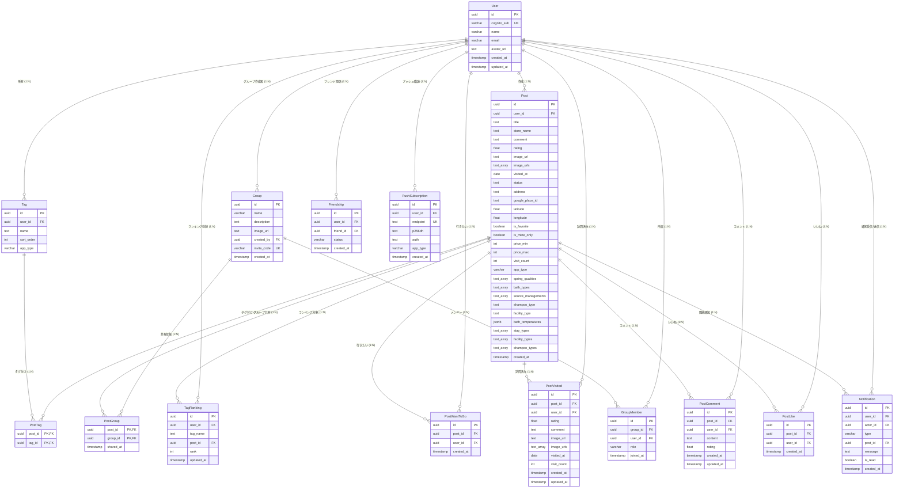

# 食べレコ データベース詳細仕様書 (DATABASE_SPECIFICATION.md)

本ドキュメントは、「食べレコ（tabereco）」で採用されているデータベース構成、Prisma スキーマ定義、全15テーブルのカラム定義、リレーションシップ、インデックス、およびMermaid形式のER図をまとめた技術仕様書です。

---

## 1. データベース概要

* **データベースエンジン:** PostgreSQL (Supabase / AWS RDS等)
* **ORM:** Prisma Client v6.3.1
* **接続管理:**
  - `DATABASE_URL`: コネクションプーリング接続用 URL
  - `DIRECT_URL`: マイグレーション（`prisma migrate`）用直接接続 URL
* **モデル数:** 15モデル（全テーブルは小文字複数形のスネークケース `@@map("...")` でマッピング）
* **主キー戦略:** 原則として全テーブルで `UUID v4` (`@id @default(uuid()) @db.Uuid`) を採用。

---

## 2. データベース ER図 (Mermaid)

---

## 3. 全テーブル詳細定義

### 3.1 `users` テーブル
ユーザーアカウント情報。AWS Cognito User Pool と同期管理。

| カラム名 | 型 | NULL | 初期値 / 制約 | 説明 |
| :--- | :--- | :---: | :--- | :--- |
| `id` | UUID | NO | PK (`default(uuid())`) | 内部ユーザーID |
| `cognito_sub` | VARCHAR(255) | NO | UNIQUE | AWS Cognito の一意識別子 (UUID) |
| `name` | VARCHAR(50) | NO | - | ユーザー表示名（ニックネーム） |
| `email` | VARCHAR(255) | NO | - | メールアドレス |
| `avatar_url` | TEXT | YES | - | S3/CloudFront上のアバター画像URL |
| `created_at` | TIMESTAMP | NO | `now()` | 登録日時 |
| `updated_at` | TIMESTAMP | NO | `@updatedAt` | 更新日時 |

---

### 3.2 `groups` テーブル
ユーザー間で投稿を共有するためのグループ情報。

| カラム名 | 型 | NULL | 初期値 / 制約 | 説明 |
| :--- | :--- | :---: | :--- | :--- |
| `id` | UUID | NO | PK (`default(uuid())`) | グループID |
| `name` | VARCHAR(100) | NO | - | グループ名 |
| `description`| TEXT | YES | - | グループの説明文 |
| `image_url` | TEXT | YES | - | グループアイコン画像URL |
| `created_by` | UUID | NO | FK (`users.id`) | 作成者ユーザーID |
| `invite_code`| VARCHAR(50) | NO | UNIQUE | 参加用招待コード（ランダム文字列） |
| `created_at` | TIMESTAMP | NO | `now()` | 作成日時 |

---

### 3.3 `group_members` テーブル
グループとユーザーの所属関係（中間テーブル）。

| カラム名 | 型 | NULL | 初期値 / 制約 | 説明 |
| :--- | :--- | :---: | :--- | :--- |
| `id` | UUID | NO | PK (`default(uuid())`) | メンバーシップID |
| `group_id` | UUID | NO | FK (`groups.id`, Cascade) | グループID |
| `user_id` | UUID | NO | FK (`users.id`, Cascade) | ユーザーID |
| `role` | VARCHAR(20) | NO | `'member'` | 権限ロール (`owner`, `admin`, `member`) |
| `joined_at` | TIMESTAMP | NO | `now()` | 参加日時 |
| **複合一意** | - | - | `UNIQUE([group_id, user_id])` | 重複参加防止 |

---

### 3.4 `posts` テーブル
食事・訪問・温泉などの体験記録の主テーブル。

| カラム名 | 型 | NULL | 初期値 / 制約 | 説明 |
| :--- | :--- | :---: | :--- | :--- |
| `id` | UUID | NO | PK (`default(uuid())`) | 投稿ID |
| `user_id` | UUID | NO | FK (`users.id`, Cascade) | 記録者ユーザーID |
| `title` | TEXT | NO | - | 投稿タイトル |
| `store_name` | TEXT | YES | - | 店舗名・施設名 |
| `comment` | TEXT | YES | - | 本文・感想メモ |
| `rating` | FLOAT | YES | - | 星評価 (0.0 〜 5.0) |
| `image_url` | TEXT | YES | - | メイン代表画像URL |
| `image_urls` | TEXT[] | NO | `[]` | 登録された全画像URLリスト |
| `visited_at` | DATE | YES | - | 実際に訪問した日付 |
| `status` | TEXT | NO | `'visited'` | ステータス (`visited`, `want_to_go` 等) |
| `address` | TEXT | YES | - | 住所文字列（都道府県含む） |
| `google_place_id`| TEXT | YES | - | Google Maps Place ID |
| `latitude` | FLOAT | YES | - | 緯度 |
| `longitude` | FLOAT | YES | - | 経度 |
| `created_at` | TIMESTAMP | NO | `now()` | 作成日時 |
| `is_favorite` | BOOLEAN | NO | `false` | お気に入りフラグ |
| `is_mine_only`| BOOLEAN | NO | `false` | 自分のみ非公開フラグ |
| `price_min` | INT | YES | - | 最小価格帯（円） |
| `price_max` | INT | YES | - | 最大価格帯（円） |
| `visit_count` | INT | NO | `1` | 累計訪問回数 |
| `temperature_min`| FLOAT | YES | - | 浴槽最低温度 (旧) |
| `temperature_max`| FLOAT | YES | - | 浴槽最高温度 (旧) |
| `app_type` | VARCHAR(20)| NO | `'tabereco'` | モード種別 (`tabereco` / `tabireco`) |
| **温泉専用項目 (V1〜V3)** | | | | |
| `spring_temp_type` | TEXT | YES | `'標準温泉'` | 温度区分 |
| `spring_temp_custom`| TEXT | YES | - | カスタム温度メモ |
| `spring_temp_min` | FLOAT | YES | - | 温泉最低温度 |
| `spring_temp_max` | FLOAT | YES | - | 温泉最高温度 |
| `cold_bath_temp` | FLOAT | YES | - | 水風呂温度（度） |
| `is_source_fed` | TEXT | YES | - | 源泉掛け流し有無 |
| `bath_count` | INT | YES | - | 浴槽数 |
| `spring_quality` | TEXT | YES | - | 単一泉質 (旧) |
| `stay_type` | TEXT | YES | - | 宿泊形態 (旧) |
| `bath_type` | TEXT | YES | - | 風呂種別 (旧) |
| `hidden_spring_rating`| INT | YES | - | 秘湯度・隠れ家度 (1〜5) |
| `has_amenities` | BOOLEAN | YES | - | アメニティ有無 |
| `other_memo` | TEXT | YES | - | 設備その他自由メモ |
| `spring_qualities`| TEXT[] | NO | `[]` | 複数泉質配列 (V2) |
| `bath_types` | TEXT[] | NO | `[]` | 複数風呂種類配列 (露天, 内湯等) |
| `source_managements`| TEXT[]| NO | `[]` | 源泉管理 (循環, 消毒, 加水等) |
| `shampoo_type` | TEXT | YES | - | シャンプー種別 (単一) |
| `facility_type` | TEXT | YES | - | 施設種別 (単一) |
| `bath_temperatures`| JSONB | YES | - | 浴槽ごとの詳細温度JSON |
| `stay_types` | TEXT[] | NO | `[]` | 宿泊形態配列 (V3) |
| `facility_types`| TEXT[] | NO | `[]` | 施設形態配列 (V3) |
| `shampoo_types` | TEXT[] | NO | `[]` | シャンプー備品配列 (V3) |

---

### 3.5 `tags` テーブル
ユーザーが自由に追加・管理できる分類タグ。

| カラム名 | 型 | NULL | 初期値 / 制約 | 説明 |
| :--- | :--- | :---: | :--- | :--- |
| `id` | UUID | NO | PK (`default(uuid())`) | タグID |
| `user_id` | UUID | NO | FK (`users.id`, Cascade) | 所有ユーザーID |
| `name` | TEXT | NO | - | タグ名称（例: 「ラーメン」「サウナ」） |
| `sort_order` | INT | NO | `0` | 表示並び順 |
| `app_type` | VARCHAR(20)| NO | `'tabereco'` | モード種別 (`tabereco` / `tabireco`) |
| **複合一意** | - | - | `UNIQUE([user_id, name, app_type])` | 同一ユーザー・同一モード内での名称重複防止 |

---

### 3.6 `post_tags` テーブル
投稿とタグの多対多リレーション中間テーブル。

| カラム名 | 型 | NULL | 初期値 / 制約 | 説明 |
| :--- | :--- | :---: | :--- | :--- |
| `post_id` | UUID | NO | PK, FK (`posts.id`, Cascade) | 投稿ID |
| `tag_id` | UUID | NO | PK, FK (`tags.id`, Cascade) | タグID |
| **複合主キー** | - | - | `PRIMARY KEY (post_id, tag_id)` | 複合主キー |

---

### 3.7 `post_groups` テーブル
投稿をどのグループに共有しているかを管理する中間テーブル。

| カラム名 | 型 | NULL | 初期値 / 制約 | 説明 |
| :--- | :--- | :---: | :--- | :--- |
| `post_id` | UUID | NO | PK, FK (`posts.id`, Cascade) | 投稿ID |
| `group_id` | UUID | NO | PK, FK (`groups.id`, Cascade) | グループID |
| `shared_at` | TIMESTAMP | NO | `now()` | 共有日時 |
| **複合主キー** | - | - | `PRIMARY KEY (post_id, group_id)` | 複合主キー |

---

### 3.8 `friendships` テーブル
ユーザー間のフレンド接続（承認制）。

| カラム名 | 型 | NULL | 初期値 / 制約 | 説明 |
| :--- | :--- | :---: | :--- | :--- |
| `id` | UUID | NO | PK (`default(uuid())`) | フレンド関係ID |
| `user_id` | UUID | NO | FK (`users.id`, Cascade) | 申請側ユーザーID |
| `friend_id` | UUID | NO | FK (`users.id`, Cascade) | 相手側ユーザーID |
| `status` | VARCHAR(20)| NO | `'accepted'` | ステータス (`pending`, `accepted`) |
| `created_at` | TIMESTAMP | NO | `now()` | 成立日時 |
| **複合一意** | - | - | `UNIQUE([user_id, friend_id])` | 重複申請防止 |

---

### 3.9 `tag_rankings` テーブル
タグごとの「マイベスト」投稿順位を管理。

| カラム名 | 型 | NULL | 初期値 / 制約 | 説明 |
| :--- | :--- | :---: | :--- | :--- |
| `id` | UUID | NO | PK (`default(uuid())`) | ランキングID |
| `user_id` | UUID | NO | FK (`users.id`, Cascade) | 対象ユーザーID |
| `tag_name` | TEXT | NO | - | タグ名 |
| `post_id` | UUID | NO | FK (`posts.id`, Cascade) | 順位付けされた投稿ID |
| `rank` | INT | NO | - | 順位番号 (1, 2, 3...) |
| `updated_at` | TIMESTAMP | NO | `@updatedAt` | 更新日時 |
| **複合一意** | - | - | `UNIQUE([user_id, tag_name, post_id])` | 同一タグ・投稿での重複排除 |

---

### 3.10 `post_want_to_gos` テーブル
投稿に対する「行きたい！」ブックマーク。

| カラム名 | 型 | NULL | 初期値 / 制約 | 説明 |
| :--- | :--- | :---: | :--- | :--- |
| `id` | UUID | NO | PK (`default(uuid())`) | ID |
| `post_id` | UUID | NO | FK (`posts.id`, Cascade) | 対象投稿ID |
| `user_id` | UUID | NO | FK (`users.id`, Cascade) | アクションしたユーザーID |
| `created_at` | TIMESTAMP | NO | `now()` | 登録日時 |
| **複合一意** | - | - | `UNIQUE([post_id, user_id])` | 1人1投稿1回のみ |

---

### 3.11 `post_visiteds` テーブル
他のユーザーの投稿に対して「自分も行った！」を記録する機能。自分自身の写真やコメント、訪問日、評価を保持。

| カラム名 | 型 | NULL | 初期値 / 制約 | 説明 |
| :--- | :--- | :---: | :--- | :--- |
| `id` | UUID | NO | PK (`default(uuid())`) | ID |
| `post_id` | UUID | NO | FK (`posts.id`, Cascade) | 対象投稿ID |
| `user_id` | UUID | NO | FK (`users.id`, Cascade) | 訪問ユーザーID |
| `rating` | FLOAT | YES | - | 自分の評価 |
| `comment` | TEXT | YES | - | 自分の感想・メモ |
| `image_url` | TEXT | YES | - | 自分の写真URL（メイン） |
| `image_urls` | TEXT[] | NO | `[]` | 自分の写真URLリスト |
| `visited_at` | DATE | YES | - | 自分の訪問日 |
| `visit_count` | INT | NO | `1` | 訪問回数 |
| `created_at` | TIMESTAMP | NO | `now()` | 作成日時 |
| `updated_at` | TIMESTAMP | NO | `@updatedAt` | 更新日時 |
| **複合一意** | - | - | `UNIQUE([post_id, user_id])` | 1人1件で訪問回数管理 |

---

### 3.12 `post_comments` テーブル
投稿に対するコメント。

| カラム名 | 型 | NULL | 初期値 / 制約 | 説明 |
| :--- | :--- | :---: | :--- | :--- |
| `id` | UUID | NO | PK (`default(uuid())`) | コメントID |
| `post_id` | UUID | NO | FK (`posts.id`, Cascade) | 対象投稿ID |
| `user_id` | UUID | NO | FK (`users.id`, Cascade) | 投稿者ユーザーID |
| `content` | TEXT | NO | - | コメント本文 |
| `rating` | FLOAT | YES | - | コメント投稿時の個別評価 |
| `created_at` | TIMESTAMP | NO | `now()` | 作成日時 |
| `updated_at` | TIMESTAMP | NO | `@updatedAt` | 更新日時 |

---

### 3.13 `post_likes` テーブル
投稿に対する「いいね！」。

| カラム名 | 型 | NULL | 初期値 / 制約 | 説明 |
| :--- | :--- | :---: | :--- | :--- |
| `id` | UUID | NO | PK (`default(uuid())`) | いいねID |
| `post_id` | UUID | NO | FK (`posts.id`, Cascade) | 対象投稿ID |
| `user_id` | UUID | NO | FK (`users.id`, Cascade) | いいねしたユーザーID |
| `created_at` | TIMESTAMP | NO | `now()` | 作成日時 |
| **複合一意** | - | - | `UNIQUE([post_id, user_id])` | 1人1いいね |

---

### 3.14 `notifications` テーブル
ユーザーへのアクティビティ通知。

| カラム名 | 型 | NULL | 初期値 / 制約 | 説明 |
| :--- | :--- | :---: | :--- | :--- |
| `id` | UUID | NO | PK (`default(uuid())`) | 通知ID |
| `user_id` | UUID | NO | FK (`users.id`, Cascade) | 受信先ユーザーID |
| `actor_id` | UUID | NO | FK (`users.id`, Cascade) | アクションを起こしたユーザーID |
| `type` | VARCHAR(30)| NO | - | 種別 (`like`, `comment`, `want_to_go`, `group_invite` 等) |
| `post_id` | UUID | YES | FK (`posts.id`, Cascade) | 関連投稿ID |
| `message` | TEXT | NO | - | 通知文面 |
| `is_read` | BOOLEAN | NO | `false` | 既読フラグ |
| `created_at` | TIMESTAMP | NO | `now()` | 発生日時 |
| **インデックス**| - | - | `INDEX([user_id, is_read])` | 未読件数・一覧取得の高速化 |

---

### 3.15 `push_subscriptions` テーブル
Web Push (Service Worker) 購読エンドポイント情報。

| カラム名 | 型 | NULL | 初期値 / 制約 | 説明 |
| :--- | :--- | :---: | :--- | :--- |
| `id` | UUID | NO | PK (`default(uuid())`) | 購読ID |
| `user_id` | UUID | NO | FK (`users.id`, Cascade) | 購読ユーザーID |
| `endpoint` | TEXT | NO | UNIQUE | Push サービスエンドポイントURL |
| `p256dh` | TEXT | NO | - | 暗号化クライアント公開鍵 |
| `auth` | TEXT | NO | - | 認証シークレット |
| `app_type` | VARCHAR(20)| NO | `'tabereco'` | モード種別 (`tabereco` / `tabireco`) |
| `created_at` | TIMESTAMP | NO | `now()` | 購読登録日時 |

---

## 4. データ保護・アクセス制御・カスケード削除のルール

1. **カスケード削除 (ON DELETE CASCADE)：**
   - ユーザー (`users`) が削除されると、そのユーザーに紐づく `posts`, `tags`, `group_members`, `friendships`, `tag_rankings`, `reactions`, `notifications`, `push_subscriptions` はすべて自動的にカスケード削除されます。
   - 投稿 (`posts`) が削除されると、紐づく `post_tags`, `post_groups`, `tag_rankings`, `post_want_to_gos`, `post_visiteds`, `post_comments`, `post_likes`, `notifications` が自動的にカスケード削除されます。
2. **データの所有権とアクセス制限：**
   - `posts.is_mine_only = true` のレコードは、投稿者本人のみに表示され、グループ内タイムラインや他者の検索結果には表示されません。
   - グループ共有された投稿 (`post_groups`) は、該当グループの有効なメンバー（`group_members` に存在）のみが閲覧可能です。
3. **画像・ファイルの参照整合性：**
   - 画像URL（`image_url`, `image_urls`）には、S3/CloudFront の絶対URL（`https://${NEXT_PUBLIC_CLOUDFRONT_DOMAIN}/uploads/...`）が格納されます。
   - 投稿編集で画像が削除された場合、DB配列から除外されます（S3実ファイルのガベージコレクションは定期バッチまたは今後の拡張課題）。
