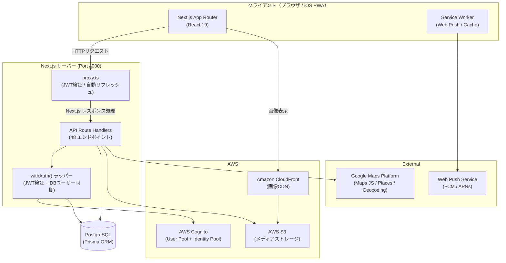
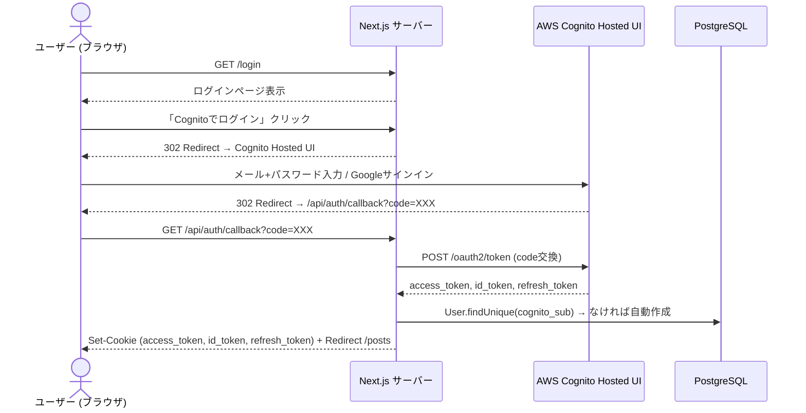
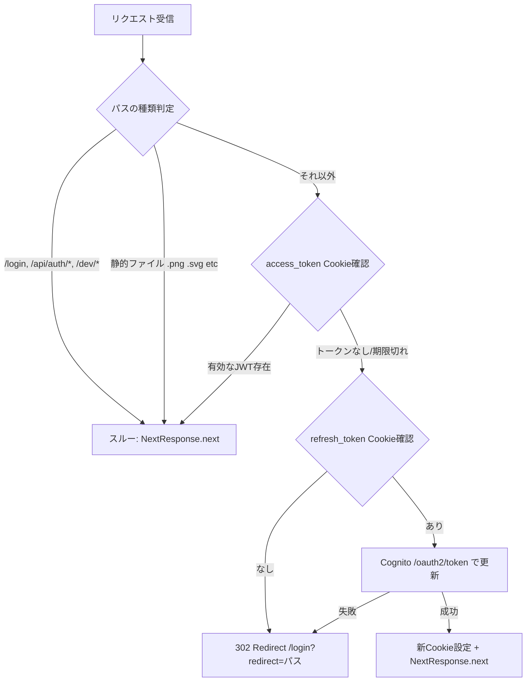
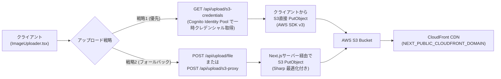
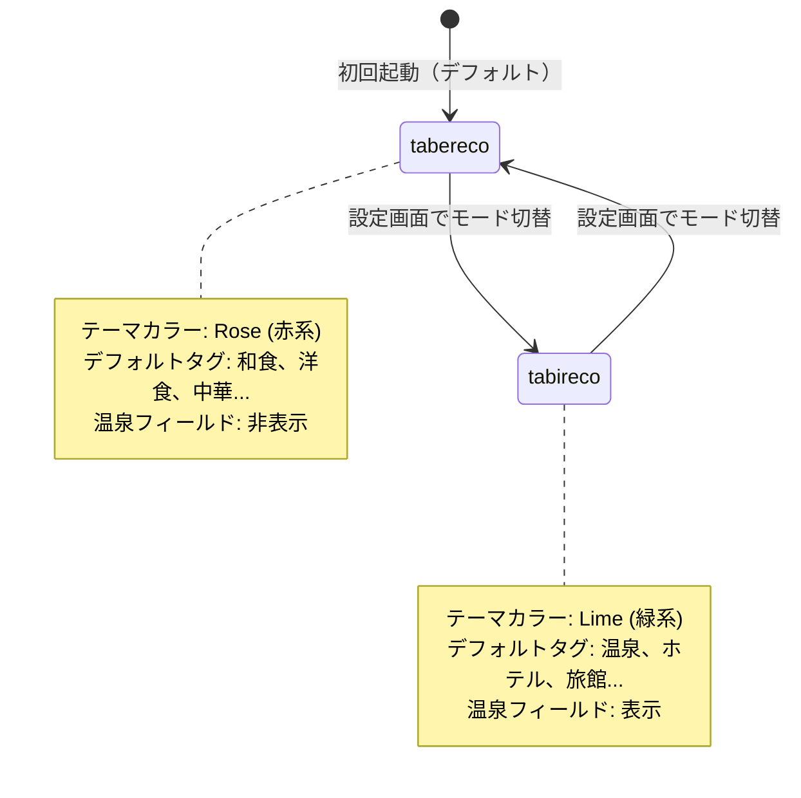
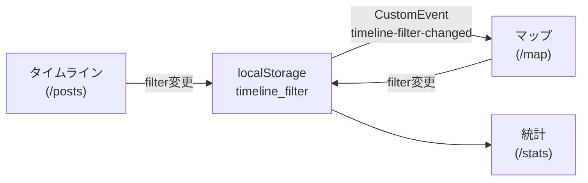
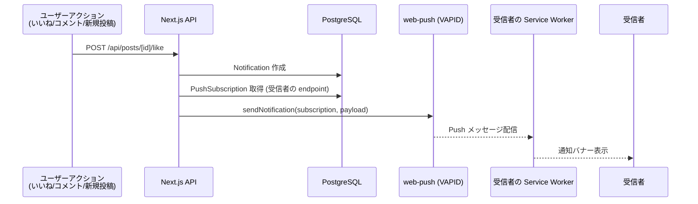

# 食べレコ 技術アーキテクチャ詳細書 (TECHNICAL_DOCUMENTATION.md)

本ドキュメントは、「食べレコ（mogureco）」の内部アーキテクチャ、認証フロー、画像ストレージ、画面間フィルター共有、デュアルモード設計、環境変数、外部依存サービスの詳細技術仕様をまとめたドキュメントです。

---

## 1. アーキテクチャ全体図



---

## 2. 認証・セッション管理アーキテクチャ

### 2.1 認証フロー (OAuth 2.0 Authorization Code Flow)



### 2.2 トークン管理・セッション自動更新

| Cookie名 | 有効期間 | HttpOnly | 用途 |
| :--- | :--- | :---: | :--- |
| `access_token` | 1時間 (expires_in) | ✅ | APIリクエスト認証用 JWT |
| `id_token` | 1時間 (expires_in) | ✅ | Cognito Identity Pool の認証用 |
| `refresh_token` | 30日間 (ローリング) | ✅ | アクセストークン自動更新用 |
| `app_type` | 1年間 | ❌ | アプリモード識別 (`tabereco`/`tabireco`) |

### 2.3 proxy.ts（Next.js ミドルウェア）の動作フロー



**ポイント:** JWTのデコードは `atob()` による期限値（`exp`）の確認のみで、署名検証は行いません。実際の署名検証は API ハンドラ内の `withAuth()` → `verifyCognitoToken()` で実施されます。

### 2.4 withAuth() の動作フロー（APIレイヤー認証）

1. `request.cookies.get('access_token')` を取得
2. `aws-jwt-verify` ライブラリで Cognito の JWKS を使って JWT 署名検証
3. 検証失敗 → `refresh_token` で更新を試みる
4. `cognitoPayload.sub` で `users` テーブルを検索 → 存在しなければ自動作成（初回ログイン対応）
5. 新規ユーザー作成時: `tabireco` 用のデフォルトタグ（「温泉」「ホテル」「旅館」等）を自動登録
6. `AuthContext`（userId, cognitoSub, email, groupId, idToken）をハンドラーに渡す

### 2.5 iOS PWA セッション保持（SessionKeepAlive）

iOS PWAでは、アプリをホーム画面から起動した場合に `document.cookie` が保持されないケースがあります。これを回避するための仕組み:

- **ログイン成功時:** `refresh_token` の値を `localStorage['tabereco_rt']` にも保存
- **SessionKeepAlive コンポーネント:** アプリ起動時（マウント時）に `localStorage['tabereco_rt']` が存在し、かつ `refresh_token` Cookie がない場合、自動的に `/api/auth/refresh` を呼び出してセッションを復元する

---

## 3. 画像ストレージ & アップロードアーキテクチャ

### 3.1 S3アップロードの2系統



### 3.2 画像URLの内部管理

- DBには S3の**オブジェクトキー（パス）のみ**を保存するのが理想的な設計（`toS3Key()` 関数でURLから変換）。
- フロントエンドでの表示時は `NEXT_PUBLIC_CLOUDFRONT_DOMAIN` と結合して完全URLを生成。

```typescript
// src/lib/image.ts の toS3Key()
// "https://cloudfront.net/uploads/users/xxx/photo.jpg" → "uploads/users/xxx/photo.jpg"
```

### 3.3 画像最適化パイプライン（サーバー側）

`/api/upload/file` エンドポイントでは、`sharp` ライブラリを使って以下を自動処理:
- 最大幅 1200px に縮小（アスペクト比維持）
- JPEG 品質 80% で圧縮
- EXIF メタデータ除去（プライバシー保護）
- WebP への変換（要件確認）

---

## 4. デュアルモード設計（食べレコ ⇄ 旅レコ）

### 4.1 モード切り替えの仕組み



### 4.2 モード管理の実装レイヤー

| レイヤー | 実装 | 詳細 |
| :--- | :--- | :--- |
| **状態管理** | `AppTypeContext.tsx` | React Context で `appType: 'tabereco' \| 'tabireco'` を保持 |
| **永続化** | `app_type` Cookie | `document.cookie` に最大1年間保存。`SameSite=Lax` |
| **テーマ切替** | `data-app-type` HTML属性 + CSS変数 | `document.documentElement.setAttribute('data-app-type', type)` |
| **データ分離** | `posts.app_type`, `tags.app_type`, `push_subscriptions.app_type` | DB レコードレベルでモードを識別 |
| **API分離** | Cookie `app_type` を全APIで読み取り | `request.cookies.get('app_type')?.value` でフィルタリング |

### 4.3 CSS変数によるテーマ切替

```css
/* globals.css (概念) */
:root { --primary: /* Rose */ }
[data-app-type="tabireco"] { --primary: /* Lime */ }
```

### 4.4 モード切り替え時の動作

1. `setAppType(type)` を呼び出す
2. Cookie 書き込み + `data-app-type` HTML属性更新（テーマCSS即時切替）
3. SWR キャッシュを全クリア（`mutate(() => true, undefined, { revalidate: true })`）
4. `window.location.reload()` でページ全体をリロードして新モードのデータを取得

---

## 5. 画面間フィルター共有（useSharedFilter）

複数の画面（タイムライン `/posts`、マップ `/map`、統計 `/stats`）でフィルター状態をリアルタイム同期する仕組み。

### 5.1 アーキテクチャ



### 5.2 localStorage キー仕様

| キー | 内容 |
| :--- | :--- |
| `timeline_filter` | 現在適用中のフィルター（JSON文字列）: `keyword`, `selectedTags`, `statusFilter`, `shareFilter`, `prefecture` 等 |
| `tabereco_rt` | iOS PWA用セッション復元リフレッシュトークン |

### 5.3 同期トリガー

- フィルター変更時に `localStorage.setItem('timeline_filter', JSON.stringify(filter))` を実行
- 同一タブ内の他コンポーネントへは `window.dispatchEvent(new CustomEvent('timeline-filter-changed', { detail: filter }))` で通知
- コンポーネントは `useEffect` で `window.addEventListener('timeline-filter-changed', handler)` を登録してリッスン

---

## 6. Google Maps / Places 連携

### 6.1 使用APIと用途

| API名 | 用途 |
| :--- | :--- |
| Maps JavaScript API | `/map` 画面の地図ビュー表示 |
| Places Autocomplete | 投稿フォームの店名入力でのサジェスト |
| Place Details | 選択した場所の住所・緯度経度・営業時間の取得 |
| Geocoding API | 住所文字列から緯度経度への変換 |
| Places Photos | 店舗の参考写真のURL取得 |

### 6.2 実装上の注意点

- API キーは `NEXT_PUBLIC_GOOGLE_MAPS_API_KEY` として公開される（ブラウザ送信）ため、**Google Cloud Console で HTTP リファラー制限**を設定することが必須。
- Places Autocomplete はモバイル（タッチデバイス）でのスクロール問題（スクロール操作が選択イベントとして誤認識される）への対策として、`pointer-events: none` やスクロール制御の追加実装が施されている（`PlaceAutocomplete.tsx`）。

---

## 7. 環境変数一覧

> ⚠️ **セキュリティ:** 以下に実際の値・シークレットは一切記載しません。変数名と用途のみ示します。

### 7.1 サーバーサイド環境変数（`.env`）

| 変数名 | 用途 |
| :--- | :--- |
| `DATABASE_URL` | PostgreSQL のコネクションプーリング接続URL（Prisma Client用）|
| `DIRECT_URL` | PostgreSQL の直接接続URL（Prisma Migrate用）|
| `COGNITO_REGION` | AWS リージョン（例: `ap-northeast-1`）|
| `COGNITO_USER_POOL_ID` | AWS Cognito ユーザープールID |
| `COGNITO_CLIENT_ID` | Cognito アプリクライアントID |
| `COGNITO_CLIENT_SECRET` | Cognito アプリクライアントシークレット（PKCE非使用の場合）|
| `COGNITO_DOMAIN` | Cognito ホステッドUIドメイン（例: `your-domain.auth.region.amazoncognito.com`）|
| `COGNITO_IDENTITY_POOL_ID` | Cognito Identity Pool ID（S3直接アップロード用一時クレデンシャル発行）|
| `AWS_S3_BUCKET_NAME` | S3バケット名 |
| `AWS_REGION` | S3用AWSリージョン |
| `VAPID_PRIVATE_KEY` | Web Push 通知用 VAPID 秘密鍵 |
| `VAPID_CONTACT_EMAIL` | Web Push 通知用 連絡先メールアドレス |

### 7.2 クライアントサイド環境変数（`NEXT_PUBLIC_*`）

| 変数名 | 用途 |
| :--- | :--- |
| `NEXT_PUBLIC_CLOUDFRONT_DOMAIN` | CloudFront ディストリビューションドメイン（画像配信URL構築用）|
| `NEXT_PUBLIC_GOOGLE_MAPS_API_KEY` | Google Maps JavaScript API キー（ブラウザ公開用）|
| `NEXT_PUBLIC_VAPID_PUBLIC_KEY` | Web Push 通知用 VAPID 公開鍵（Service Worker登録用）|

---

## 8. PWA (Progressive Web App) 構成

### 8.1 マニフェスト

- `/api/manifest` エンドポイントが動的に生成する（`app_type` Cookie に応じてアイコンと名称を切り替え）。
- `food-reco` (食べレコ): アイコン `/icon-192.png`, テーマカラー Rose系
- `tabi-reco` (旅レコ): アイコン `/tabireco-192.png`, テーマカラー Lime系

### 8.2 Service Worker (`public/sw.js`)

- **Web Push 受信:** `push` イベントをリッスンし、通知を表示
- **通知クリック:** `notificationclick` イベントで対象URLを開く
- **オフラインキャッシュ:** 基本的なページキャッシュ（要確認）

### 8.3 Web Push 配信フロー



---

## 9. Prisma ORM の利用方針

### 9.1 クライアント初期化（シングルトン）

```typescript
// src/lib/prisma.ts
import { PrismaClient } from '@prisma/client';

const globalForPrisma = globalThis as unknown as { prisma: PrismaClient };
export const prisma = globalForPrisma.prisma ?? new PrismaClient();
if (process.env.NODE_ENV !== 'production') globalForPrisma.prisma = prisma;
```

開発環境でのホットリロード（HMR）時の多重インスタンス作成を防ぐため、`globalThis` にシングルトンとして保持。

### 9.2 マイグレーション管理

```bash
# 新規マイグレーション作成
npx prisma migrate dev --name "migration_name"

# 本番適用
npx prisma migrate deploy

# スキーマからクライアント再生成
npx prisma generate

# DB GUI ブラウザで確認
npx prisma studio
```

---

## 10. React 状態管理パターン

| パターン | 用途 |
| :--- | :--- |
| **SWR** | サーバーデータの取得・キャッシュ・再検証（投稿一覧、タグ一覧等）|
| **React Context** | アプリ横断の状態（`AppTypeContext`, `PostUploadContext`）|
| **URL Query Params** | フィルター状態のURL共有（タイムライン絞り込み）|
| **localStorage** | 画面間フィルター状態の共有（`useSharedFilter`）|
| **Cookie** | セッション・認証トークン・アプリモード |
| **useState / useReducer** | コンポーネントローカルの UI 状態 |
